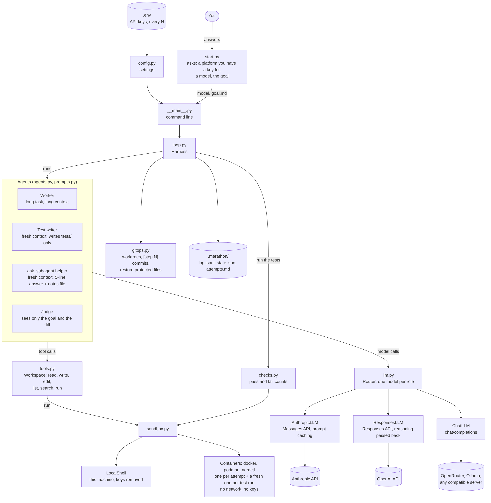
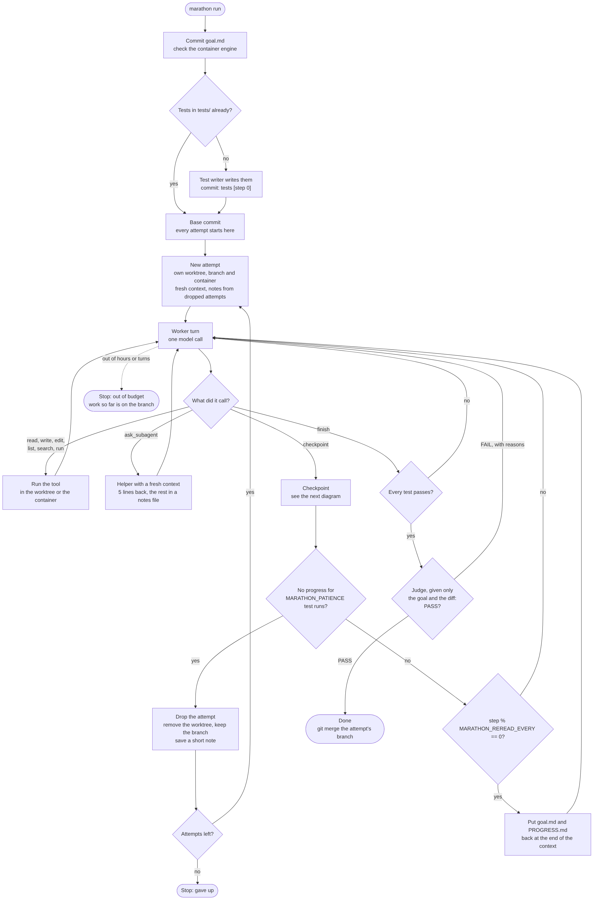
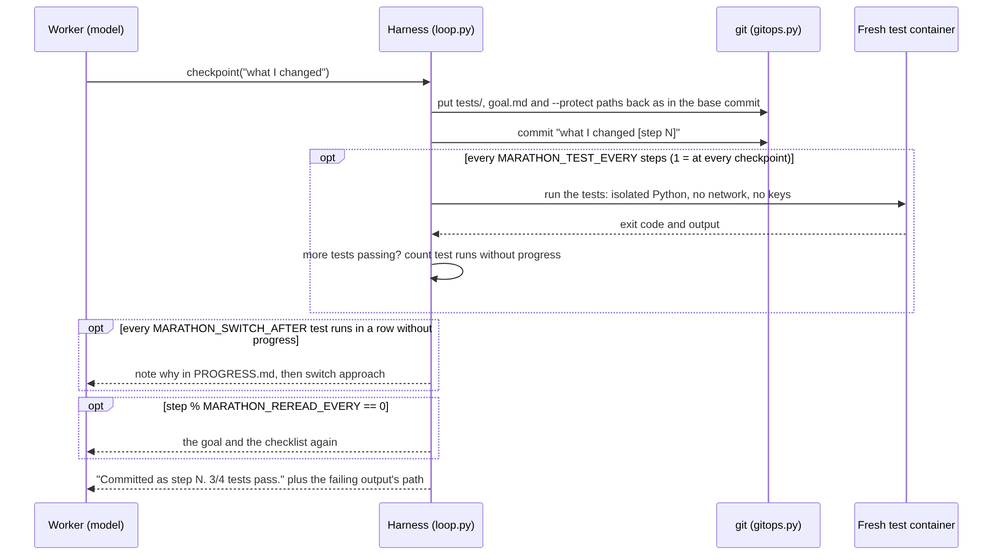

# marathon

A bare-bones loop for coding agents that run for hours on one goal, with nobody watching.

It's the code version of the talk *Agents That Don't Lose the Plot* by Ravi Vats (XConf APAC 2026).
[The fixes from the talk](#the-fixes-from-the-talk) shows how each fix works here.
Plain Python 3.10+, standard library only, about 1,800 lines. It works with Claude through
Anthropic's own API, with OpenAI, OpenRouter and Ollama, or with any OpenAI-compatible server,
and it can run every command in a container.

**How it fits together:** [docs/architecture.md](docs/architecture.md) has the diagrams below as
Mermaid source, with a table of which file does what.

[](docs/architecture.md#the-parts)

## Try it in 10 seconds (no API key)

```bash
python3 -m marathon demo
```

The demo replays a prepared run in a throwaway repo, so it runs offline with no API key. You can
watch the whole harness at work: the test writer, the `[step N]` commits, the test runs, the goal
re-reads, undoing edits to the tests, the nudge to switch approach, dropping the stuck attempt, a
fresh worktree, the helper's notes and the judge. To run it on your own goal with a model, see
[Run it for real](#run-it-for-real).

```
No tests yet. A separate test-writer agent is writing them on marathon/<run>/tests.
Tests committed: 4 tests for slugify
Attempt 1 starts on marathon/<run>/attempt-1. Right now: 0/1 tests pass.
[attempt 1 | step 1] 0/4 tests pass (no progress 1/3)
[attempt 1 | step 2] 0/4 tests pass (no progress 2/3)
[attempt 1 | step 2] step % 2 == 0: the goal goes back in front of the agent
[attempt 1 | step 2] 2 checkpoints without progress: told the agent to note why and switch approach
[attempt 1 | step 3] 0/4 tests pass (no progress 3/3) [undid edits to read-only files: tests/test_slug.py]
[attempt 1] No progress in 3 checkpoints. Dropping this plan. The next attempt starts in a fresh worktree.
Attempt 2 starts on marathon/<run>/attempt-2. Right now: 0/1 tests pass.
[attempt 2 | step 1] 2/4 tests pass (progress)
[attempt 2 | step 2] 4/4 tests pass (progress)
[attempt 2 | step 2] step % 2 == 0: the goal goes back in front of the agent
[attempt 2 | step 3] tests pass, judge says PASS
Done at step 3: 4/4 tests pass, judge PASS.
```

## Setup

You need Python 3.10 or newer and git; marathon itself has no packages to install. To run the
agent's commands in containers (the setting in `.env.example`), you also need a container engine.
Install Docker Desktop, or Colima with:

```bash
brew install colima docker && colima start
docker context use colima     # point the docker command at Colima
```

Then:

```bash
git clone https://github.com/ravivats/marathon-agent.git
cd marathon-agent
cp .env.example .env      # then add the API key for each platform you want to use
```

`.env` holds your API keys and every setting. That includes the numbers behind the fixes:

- how often the goal is re-read (`MARATHON_REREAD_EVERY`, every 5 steps)
- how often the tests run (`MARATHON_TEST_EVERY`, every step)
- when the agent is told to switch approach (`MARATHON_SWITCH_AFTER`, after 3 test runs with no progress)
- when an attempt is dropped (`MARATHON_PATIENCE`, after 25)

Every line in [`.env.example`](.env.example) says what it does. marathon reads `.env` from the
folder you run it in, or from the marathon-agent folder, and `--env-file` points at another file.
A flag beats an environment variable, which beats `.env`, which beats the built-in default.

Keep `.env` in the marathon-agent folder. It's git-ignored, and marathon warns you if it finds
one inside the repo the agent works on, where the agent could read your keys.

## Run it for real

### With your API key, step by step

1. Copy the settings file, if you haven't yet:

   ```bash
   cp .env.example .env
   ```

2. Open `.env` and put your key on the line for your platform. For OpenAI:

   ```
   OPENAI_API_KEY=<your key>
   ```

   For the others, use `ANTHROPIC_API_KEY` or `OPENROUTER_API_KEY`. You can fill in more than one;
   marathon asks which platform to use. Don't paste keys anywhere else, and don't commit `.env`
   (it's git-ignored).

3. Choose where the agent's commands run, with `MARATHON_SANDBOX` in `.env`:
   - `docker` (the setting in `.env.example`): in containers, the safe choice for long runs. Start
     Colima or Docker first, for example with `colima start`.
   - `local`: directly on your machine, which is fine for a short try.

4. From the marathon-agent folder, start a run on a project folder. It's created if it's new:

   ```bash
   python3 -m marathon run --repo ~/work/my-project
   ```

It then asks three things before it starts, for example:

```
Platforms you have an API key for:
  1. Anthropic  (ANTHROPIC_API_KEY found)
  2. OpenAI  (OPENAI_API_KEY found)
Choose 1-2 [1]: 1
Looking up models on Anthropic ...
Models on Anthropic, newest first:
  1. claude-sonnet-5-5  (suggested)
  2. claude-opus-5-5
  ...
Choose 1-12, or type a model name [1]:

What should the agent do? Describe the goal in your own words: what to build,
and how you'll know it's done.
Finish with an empty line.
> (your goal, as many lines as you need)
>

Ready to start:
  project   /Users/you/work/my-project
  goal      (the first line of your goal)
  model     anthropic:claude-sonnet-5-5
  commands  in docker containers from python:3.12-slim, no network
  budget    8 hours or 600 model turns
Start? [Y/n]
```

- **Platform:** only the platforms with a key in `.env` (or your environment) are offered. With
  one key, that platform is used without asking.
- **Model:** the list comes from the platform itself, newest first. The suggestion comes from
  `MARATHON_ANTHROPIC_MODEL`, `MARATHON_OPENAI_MODEL` or `MARATHON_OPENROUTER_MODEL`, and you can
  type any model name instead.
- **Goal:** your own words, saved as `goal.md` in the project. If the project already has one,
  pressing Enter keeps it. Nothing is written until you answer yes.
- `--model` and `--prompt` answer the questions up front. For unattended runs, like a schedule,
  `--no-input` asks nothing: it uses `MARATHON_MODEL` and the project's `goal.md` (or `--prompt`).
- If you'd rather write the goal in an editor, `python3 -m marathon init PATH` makes a `goal.md`
  to fill in.

For more on containers, see [Run the agent's commands in containers](#run-the-agents-commands-in-containers).

You can also point `run` at an existing repo. Put a `goal.md` in it. If it already has tests in
`tests/`, those are used and no tests are written.

When it's done, the work is on a branch: `git merge marathon/<run>/attempt-<n>`.

### Models and API keys

In a terminal you pick the platform and the model when the run starts. Otherwise the model comes
from `MARATHON_MODEL` or `--model`, written as `provider:model`. Each key goes in `.env` under that
provider's usual name (or in your environment).

| Provider | `--model` example | API key from |
|---|---|---|
| `anthropic` | `anthropic:claude-sonnet-5-5` | `ANTHROPIC_API_KEY` |
| `openai` | `openai:<model>` | `OPENAI_API_KEY` |
| `openrouter` | `openrouter:<vendor>/<model>` | `OPENROUTER_API_KEY` |
| `ollama` | `ollama:qwen3:8b` | none, it runs on your machine |

Claude goes through Anthropic's own Messages API with prompt caching, so most of a long run's
growing prompt is read from the cache, which is cheaper and faster. OpenAI goes through its
Responses API, which the newest OpenAI models (the pro models, for example) need. Their reasoning
is handed back between tool calls in encrypted form, and nothing is stored at OpenAI. OpenRouter
and Ollama go through the OpenAI-compatible `/chat/completions`. Any other OpenAI-compatible server works with
`--base-url`, plus `--api-key` or `MARATHON_API_KEY` if it needs a key. A name without a provider,
like `MARATHON_MODEL=gpt-x`, uses `--provider` (or `MARATHON_PROVIDER`), which defaults to `openai`.

Each role can have its own model. The helpers are the test writer and `ask_subagent`:

```bash
python3 -m marathon run --repo ~/work/my-project \
  --model anthropic:claude-opus-5-5 \
  --helper-model anthropic:claude-haiku-5-5 \
  --judge-model openai:<model>      # a judge from another model family is a cheap second opinion
```

The same works with `MARATHON_MODEL`, `MARATHON_HELPER_MODEL` and `MARATHON_JUDGE_MODEL` in `.env`.
Mixing providers is fine: each one uses its own key.

**Keep keys out of the agent's reach.** Only the harness reads them. The commands the agent runs
never see them: on this machine, any variable with KEY, TOKEN, SECRET or PASSWORD in its name is
removed, and a container gets only `HOME`. Keep `.env` in the marathon-agent folder, never in the
repo you point marathon at, because the agent can read every file there.

### Run the agent's commands in containers

```bash
brew install colima docker   # a small Linux VM and the docker CLI, no Docker Desktop needed
colima start
docker context use colima     # point the docker command at Colima
python3 -m marathon run --repo ~/work/my-project   # MARATHON_SANDBOX=docker in .env, or --sandbox docker
```

Any Docker-compatible CLI works. Colima runs the Docker engine in a light VM and gives you the
plain `docker` command, so `--sandbox docker` is all it needs. Docker Desktop works the same way.
Use `--sandbox podman` for Podman, or `--sandbox nerdctl` for Colima's containerd runtime.

- Each attempt gets its own container for the agent's `run` commands. Anything it installs there
  lasts until the attempt ends.
- Every test run gets a fresh container, so nothing the agent did in its own container can change
  the result.
- There's no network unless you pass `--allow-network`. Containers get no API keys, run as your
  user so the files stay yours, and have all Linux capabilities dropped.
- The attempt's worktree is mounted at `/work`. Git runs on your machine, outside the container.
- The image is `python:3.12-slim`, pulled once. For another language, use an image with its
  toolchain (`--image node:22`) and a matching `--test-cmd`.
- Colima shares your home folder with its VM by default, so keep the repo under your home folder.
- If Colima is running but your `docker` command points elsewhere (`docker info` shows
  `Context: default` and can't connect), marathon finds Colima's socket in
  `~/.colima/<profile>/docker.sock` and uses it. Run `docker context use colima` to point plain
  `docker` commands at Colima too.

## How a run works

[](docs/architecture.md#one-run)

1. **Tests first, by someone else.** If there are no tests, a separate test-writer agent, with its
   own fresh context, reads `goal.md` and writes them. It can only write inside `tests/`. That
   commit is the base for every attempt.
2. **One attempt = one worktree, one branch and, with `--sandbox`, one container.** The worker
   gets a short system prompt, the goal, and six small tools: `read_file`, `write_file`,
   `edit_file`, `list_files`, `search`, `run`. Plus `ask_subagent`, `checkpoint` and `finish`.
3. **Checkpoints are steps.** When the worker calls `checkpoint`, the harness undoes any edits to
   `tests/`, `goal.md` and anything in `--protect`, commits everything as
   `"<summary> [step N]"`, and runs the tests itself (in a fresh container, with `--sandbox`).
   The tests run at every step by default, or every `MARATHON_TEST_EVERY` steps.
   If the worker forgets, the harness makes a checkpoint every 15 turns.
4. **The goal comes back every N steps.** When `step % N == 0`, `goal.md` is read from disk again
   and put at the end of the context, with the checklist in `PROGRESS.md`. There is a backup
   schedule every 20 model turns too.
5. **Plans are temporary.** Progress means more tests passing (or a higher score, see below). Every
   3 test runs in a row with no progress, the agent is told to write down why and switch
   approach. After 25 test runs in a row with no progress (`MARATHON_PATIENCE`), the attempt
   is dropped:
   its folder goes, its branch stays, a short note is kept, and the next attempt starts in a
   fresh worktree with a fresh context.
6. **"Done" has to be earned.** `finish` only counts when every test passes and a judge, which sees
   only the goal and the final diff, says PASS. Otherwise the reason goes back to the worker.

What happens at one checkpoint:

[](docs/architecture.md#one-checkpoint)

## The fixes from the talk

The talk gives ten fixes for long runs, each one tied to a problem from its case studies, plus one
"going further" idea. Slide 33 of the deck points to this repo and lists five of them. Those five come
first below, with the code that does the work and the unit tests that check it. The other five are in
the table after them. You can watch all five happen in `python3 -m marathon demo`.

### Fix 1. Re-read the goal on a schedule

**Problem in the talk: goal drift.** Hours into a run, the goal sits far back in the context and the
agent follows whatever it was doing last.

- Every checkpoint is a git commit whose message ends in `[step N]`. The step number is read back from
  the commit log, so the commits are the record of how far the run got.
- When `step % N == 0`, the harness reads `goal.md` from disk again and puts it at the end of the
  context, with the checklist from `PROGRESS.md`, the last and best test results, and the number of
  checkpoints without progress. N is `MARATHON_REREAD_EVERY` in `.env` (or `--reread-every`): the
  default is 5, and the talk's example uses 25.
- A backup re-read happens every 20 model turns (`--reread-every-turns`), in case the agent rarely
  checkpoints.

Code: `gitops.is_reread_step`, `gitops.last_step`, `Harness.reread`, `prompts.reread_message`.
Tests: `test_reread_when_step_mod_n_is_zero`, `test_reread_puts_goal_and_checklist_at_the_end`.

### Fix 3. Tell the agent it can change the plan

**Problem in the talk: stuck on a bad plan.** The agent keeps patching its first plan long after it
stopped working.

- The system prompt says the plan and the steps are temporary and can be dropped at any time. If the
  same approach fails 3 times in a row, the agent writes down why in `PROGRESS.md` and tries another.
- The harness doesn't leave that rule to the model alone. After 3 test runs in a row without
  progress (`MARATHON_SWITCH_AFTER`), and again after 6, 9 and so on, the checkpoint result tells the
  agent to write down why the approach isn't working and switch to a different one.
- The harness also has a hard limit. Progress means more tests passing, or the same tests passing with a
  better score when you set `--score-cmd`. After `MARATHON_PATIENCE` test runs in a row with no
  progress (default 25), it drops the attempt. The worktree is removed, the branch is kept so you can look at
  it later, and a short note goes into `.marathon/attempts.md`.
- The next attempt starts on a new branch, in a fresh worktree, with a fresh context. It gets the
  notes from the last three dropped attempts so it doesn't repeat them. After `--max-attempts`
  (default 5) the run stops.

Code: `prompts.WORKER`, `Harness.record`, `Harness.checkpoint`, `Harness.drop`.
Tests: `test_agent_is_told_to_switch_after_3_stalls`, `test_demo_replay_end_to_end`,
`test_worktree_removed_but_branch_kept`, `test_gives_up_after_max_attempts`.

### Fix 6. Hand slices of work to sub-agents

**Problem in the talk: prompt too full.** One agent doing every job carries every detail in one
context.

Two helpers start with an empty context and do one job each:

- **The test writer.** If the repo has no tests, it reads `goal.md` and writes them before any code
  exists. It can write only inside `tests/`, and only `tests/` goes into its commit. That commit
  (`[step 0]`) is the starting point for every attempt. If the repo already has tests in `tests/`,
  those are used and no tests are written.
- **`ask_subagent`.** The worker can hand off one focused question, like "where are dates parsed?",
  with the file paths to look at. The helper answers in 5 lines or less; the harness cuts anything
  past 5 lines. If it has more to say, it writes the details to its own notes file
  (`.marathon/notes/helper-N.md`), the only file it can write, and the worker gets the path. That's
  fix 7 from the talk: pointers both ways, and only 5 lines in the worker's context.

Code: `Harness.ensure_tests`, `agents.write_tests`, `agents.ask`.
Tests: `test_test_writer_commits_only_tests`, `test_helper_answers_in_5_lines_and_leaves_notes`,
`test_writable_only`.

### Fix 9. Run checks the agent can't skip

**Problem in the talk: "done" too early.** If the agent runs its own checks, it can skip them, weaken
them, or report a pass it didn't get.

- The harness runs the tests itself, with a fixed command (`MARATHON_TEST_CMD`) and a timeout, at
  every checkpoint (or every `MARATHON_TEST_EVERY` steps) and always on `finish`. It reads the pass and fail counts from unittest or pytest output.
- The worker's file tools refuse to write to `tests/` and `goal.md`. Since `run` can still execute
  any shell command, the harness also puts both back exactly as they are in the base commit before
  every commit. Edits, new files and deletions there are undone, and the agent is told.
- Files outside `tests/` can change a test run too. `--protect PATH` makes more of them read-only
  in the same way, like the `Makefile` when the test command is `make test`, or `conftest.py` with
  pytest.
- The default test command is an isolated unittest run. With a plain `python3 -m unittest`, a
  `unittest.py` that the agent adds next to the code is imported in place of the real one and
  can print "OK" while the tests fail. The default runs Python with `-I`, so the repo folder isn't
  on the import path at start-up, and it puts the folder at the end of the path, after the
  standard library. `tests/` doesn't need an `__init__.py`.
- With `--sandbox`, every test run happens in a fresh container, so nothing the agent installed or
  changed in its own container can affect it.
- If the agent goes 15 model turns without a checkpoint (`--force-checkpoint-every`), the harness
  makes one and runs the tests anyway.
- The test writer is told to write deterministic tests: no network, no clocks, no randomness
  without a fixed seed.

The judge in Fix 10 covers what a test run can't: code that cheats from inside the test process,
for example by printing a passing result and exiting early, shows up in the diff the judge reads.

Code: `checks.run_tests`, `gitops.restore`, `Harness.commit`, `Workspace.check_write`,
`Sandbox.run_once`, `config.DEFAULT_TEST_CMD`.
Tests: `test_default_command_ignores_files_that_fake_a_pass`,
`test_protected_paths_are_restored_and_read_only`, `test_restore_undoes_edits_adds_and_deletes`,
`test_protected_paths_are_read_only`, `test_harness_checkpoints_when_the_agent_forgets`.

### Fix 10. A judge that sees only the ask and the diff

**Problem in the talk: "done" too early.** A reviewer that has read the agent's reasoning tends to
agree with it.

- `finish` only counts when every test passes. Until then the agent gets the failing output back and
  carries on.
- Then a judge gets two things: the goal and the final diff (without `PROGRESS.md` and the tests).
  It sees no history, no reasoning and no earlier attempts. Its first line must be PASS or FAIL.
- On FAIL, the judge's reasons go back to the worker, and the attempt goes on.

Code: `Harness.finish`, `agents.judge`.
Tests: `test_finish_is_rejected_while_tests_fail`, `test_judge_sees_only_goal_and_diff`.

### The other fixes

| Fix | Problem in the talk | In the code | Code |
|---|---|---|---|
| 2. Keep a checklist, and check against it | Mistakes pile up | The agent keeps `PROGRESS.md`, and every re-read shows it next to the goal and the latest test results. The talk re-runs the tests every 10 steps. Here they run at every checkpoint by default; set `MARATHON_TEST_EVERY=10` to match the talk. | `prompts.reread_message`, `Harness.checkpoint` |
| 4. Use a lighter harness | Light harness, composable tools | A system prompt of about 20 lines and six general tools: `read_file`, `write_file`, `edit_file`, `list_files`, `search`, `run`. Three more (`checkpoint`, `finish`, `ask_subagent`) are how the agent talks to the harness. | `prompts.py`, `tools.py` |
| 5. Point the agent at the data | Prompt too full | Tool output over 6,000 characters is cut to its start and end, the full text is saved to a file, and the agent gets the path. Failing test output is saved the same way. After 80 messages the oldest are dropped, keeping the system prompt and the task. | `Workspace.clip`, `Harness.test_report`, `Harness.trim` |
| 7. Hand sub-agents a pointer, too | Prompt too full | `ask_subagent` takes file paths, and the worker can put a longer brief in `.marathon/notes/`. The helper sends back 5 lines and the path of its notes file. | `agents.ask` |
| 8. Give each agent its own dev environment | "Done" too early | Each attempt gets its own git worktree and branch, and with `--sandbox docker` its own container, with no network and no API keys. Every test run gets a fresh container. See [Run the agent's commands in containers](#run-the-agents-commands-in-containers). | `gitops.add_worktree`, `sandbox.py` |
| + Going further: train the model on the pattern | Niche tasks | Not in this repo. | |

## Settings

Every setting has a `.env` name, and most have a flag too. A flag beats an environment variable,
which beats `.env`, which beats the default. [`.env.example`](.env.example) lists them all with
their defaults.

| `.env` name | Flag | Default | Meaning |
|---|---|---|---|
| `MARATHON_REREAD_EVERY` | `--reread-every` | 5 | re-read the goal when `step % N == 0`; 0 turns it off |
| `MARATHON_REREAD_EVERY_TURNS` | `--reread-every-turns` | 20 | backup re-read, counted in model turns |
| `MARATHON_TEST_EVERY` | `--test-every` | 1 | run the tests every N steps; `finish` always runs them |
| `MARATHON_SWITCH_AFTER` | `--switch-after` | 3 | test runs in a row without progress before the agent is told to switch approach; 0 turns it off |
| `MARATHON_PATIENCE` | `--patience` | 25 | test runs in a row without progress before a fresh start |
| `MARATHON_MAX_ATTEMPTS` | `--max-attempts` | 5 | fresh starts before giving up |
| `MARATHON_FORCE_CHECKPOINT_EVERY` | `--force-checkpoint-every` | 15 | model turns without a checkpoint before the harness makes one |
| `MARATHON_HOURS` / `MARATHON_MAX_TURNS` | `--hours` / `--max-turns` | 8 / 600 | budget for the whole run |
| `MARATHON_MAX_HISTORY` | `--max-history` | 80 | messages kept before the oldest are dropped |
| `MARATHON_TOOL_OUTPUT_LIMIT` | | 6000 | characters of tool output shown inline; the rest goes to a file |
| `MARATHON_CMD_TIMEOUT` | `--cmd-timeout` | 300 | seconds for any one command, tests included |
| `MARATHON_TEST_CMD` | `--test-cmd` | an isolated unittest run of `tests/` | unittest and pytest output are both understood; the default is in `config.py` |
| `MARATHON_PROTECT` | `--protect` | none | more read-only paths: comma-separated in `.env`, or repeat the flag |
| `MARATHON_SCORE_CMD` | `--score-cmd` | none | for objective goals: a command that prints a number, higher is better |
| `MARATHON_MIN_DELTA` | `--min-delta` | 0 | smallest score gain that counts as progress |
| `MARATHON_GOAL_FILE` / `MARATHON_TESTS_DIR` | `--goal-file` / `--tests-dir` | `goal.md` / `tests` | |
| `MARATHON_SANDBOX` | `--sandbox` | `local` (`docker` in `.env.example`) | where commands run: `local`, `docker`, `podman` or `nerdctl` |
| `MARATHON_IMAGE` | `--image` | `python:3.12-slim` | container image |
| `MARATHON_ALLOW_NETWORK` | `--allow-network` | off | let commands in containers use the network |
| `MARATHON_MODEL` | `--model` | none | `provider:model` for the worker; the flag skips the questions at start |
| `MARATHON_ANTHROPIC_MODEL` / `MARATHON_OPENAI_MODEL` / `MARATHON_OPENROUTER_MODEL` | | `claude-sonnet-5-5` / none / none | the model suggested for each platform at start |
| `MARATHON_HELPER_MODEL` | `--helper-model` | the worker's | the test writer and `ask_subagent` |
| `MARATHON_JUDGE_MODEL` | `--judge-model` | the worker's | the judge |
| `MARATHON_PROVIDER` | `--provider` | `openai` | for model names without a provider |
| `MARATHON_BASE_URL` / `MARATHON_API_KEY` | `--base-url` / `--api-key` | the provider's | a custom OpenAI-compatible server |
| `MARATHON_MAX_TOKENS` | `--max-tokens` | 16000 | longest reply, for Anthropic |
| `MARATHON_REQUEST_TIMEOUT` | `--request-timeout` | 600 | seconds to wait for one model reply; pro models can take minutes |
| | `--env-file` | `.env` | where to read settings and keys from |
| | `--prompt` | none | the goal, instead of being asked; saved as `goal.md` |
| | `--no-input` | off | ask nothing (for unattended runs); also the case without a terminal |

API keys go in `.env` (or your environment) as `ANTHROPIC_API_KEY`, `OPENAI_API_KEY` and
`OPENROUTER_API_KEY`.

Objective goals, like "make this function faster", can use `--score-cmd`:
progress is more tests passing, or the same tests passing with a better score.

## What it leaves behind

```
your-repo/
  .marathon/             (git-ignored)
    log.jsonl             every checkpoint, re-read, drop and judge verdict
    state.json            where the run is now
    attempts.md           notes from dropped attempts
    worktrees/attempt-N/  the attempt in progress, with helper notes in .marathon/notes/
  branches:
    marathon/<run>/tests       the test suite
    marathon/<run>/attempt-N   one per attempt, every commit ends in [step N]
```

## Code

```
marathon/
  loop.py      the main loop: attempts, checkpoints, re-reads, drops, finish
  agents.py    test writer, ask_subagent helper, judge
  tools.py     the six tools, kept inside one folder
  sandbox.py   where commands run: this machine or containers
  gitops.py    worktrees, [step N] commits, restoring protected files
  checks.py    runs the tests and reads the counts
  prompts.py   the short prompts
  llm.py       clients for Anthropic, OpenAI (Responses API) and any OpenAI-compatible server,
               the per-role router, ReplayLLM for the demo
  config.py    every setting, its default, and reading .env
  start.py     the questions at start: platform, model, goal
  demo.py      the offline demo
tests/         python3 -m unittest -v
docs/          architecture.md: diagrams of the parts, a run and a checkpoint (+ PNGs)
.env.example   every setting and API key; copy it to .env
```

## Be careful with `run`

The `run` tool executes shell commands. With the default `--sandbox local` they run on your
machine, in the attempt's folder. API keys are removed from their environment, and the harness
keeps the tests and the goal safe, but a command can still touch other files on your machine.
For real marathon runs, use `--sandbox docker` (or podman), see
[Run the agent's commands in containers](#run-the-agents-commands-in-containers).

## Not in here yet

- Resuming a run after the process stops (the state file and branches are there to build on).
- Token-based context limits (it counts messages for now).
- A web search tool (add it to `tools.py` if your goal needs one).

## License

Copyright (c) 2026 Ravi Vats.

marathon-agent is licensed under the
[Creative Commons Attribution-NonCommercial-ShareAlike 4.0 International License](https://creativecommons.org/licenses/by-nc-sa/4.0/)
(CC BY-NC-SA 4.0). The full text is in [LICENSE](LICENSE).

You may copy, change and share it for non-commercial purposes, as long as you:

- **give credit:** name Ravi Vats, link to this repo and to the license, and say if you changed it;
- **share alike:** release anything you build from it under CC BY-NC-SA 4.0 too.

For commercial use, contact Ravi Vats first.

Suggested credit:

> marathon-agent by Ravi Vats (https://github.com/ravivats/marathon-agent), licensed under CC BY-NC-SA 4.0.
