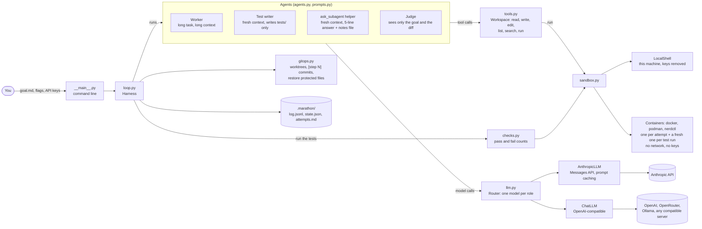
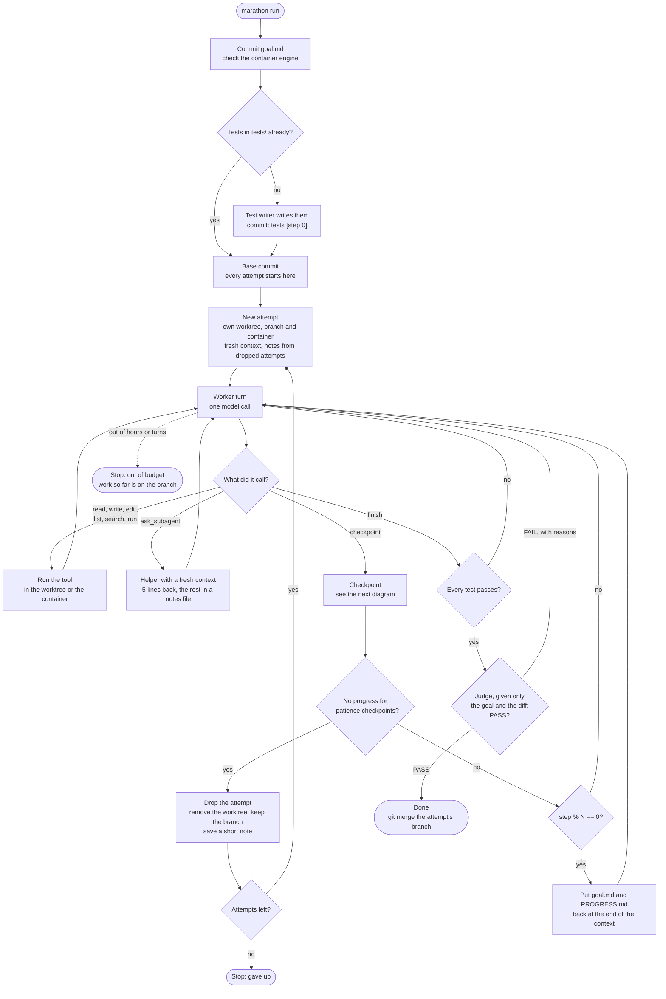
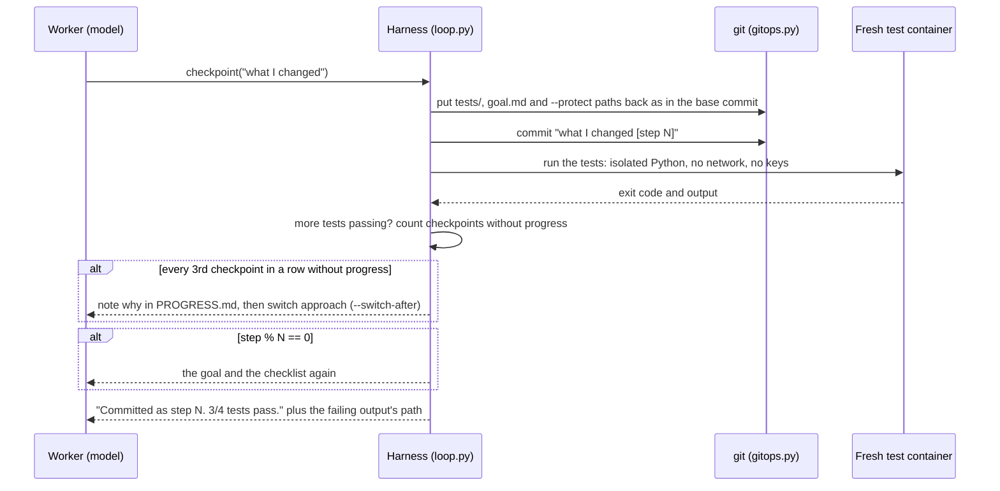

# How marathon fits together

Three diagrams: the parts and how they talk, what happens during one run, and what happens at a
single checkpoint. GitHub draws them from the Mermaid source below. Every box names the file
that does the work, so you can jump from a diagram to the code.

Back to the [README](../README.md).

## The parts

| File | Job | Fixes |
|---|---|---|
| `loop.py` | The harness: attempts, checkpoints, re-reads, the switch nudge, drops, finish | 1, 2, 3, 9, 10 |
| `agents.py` | The three helpers with a fresh context: test writer, `ask_subagent`, judge | 6, 7, 10 |
| `prompts.py` | The short prompts and the re-read message | 1, 2, 3, 4 |
| `tools.py` | Six general tools, kept inside one folder; long output goes to a file | 4, 5 |
| `sandbox.py` | Where commands run: this machine, or containers | 8, 9 |
| `checks.py` | Runs the tests (and an optional score command) and reads the counts | 9 |
| `gitops.py` | Worktrees and branches, `[step N]` commits, putting protected files back | 1, 8, 9 |
| `llm.py` | Model clients (Anthropic, OpenAI-compatible) and the per-role router | |
| `config.py` | Every setting and its default | |
| `demo.py` | The demo: a prepared run, replayed in a throwaway repo | |

## One run

## One checkpoint

## Where things live

The README's [What it leaves behind](../README.md#what-it-leaves-behind) shows the files and
branches a run creates.
